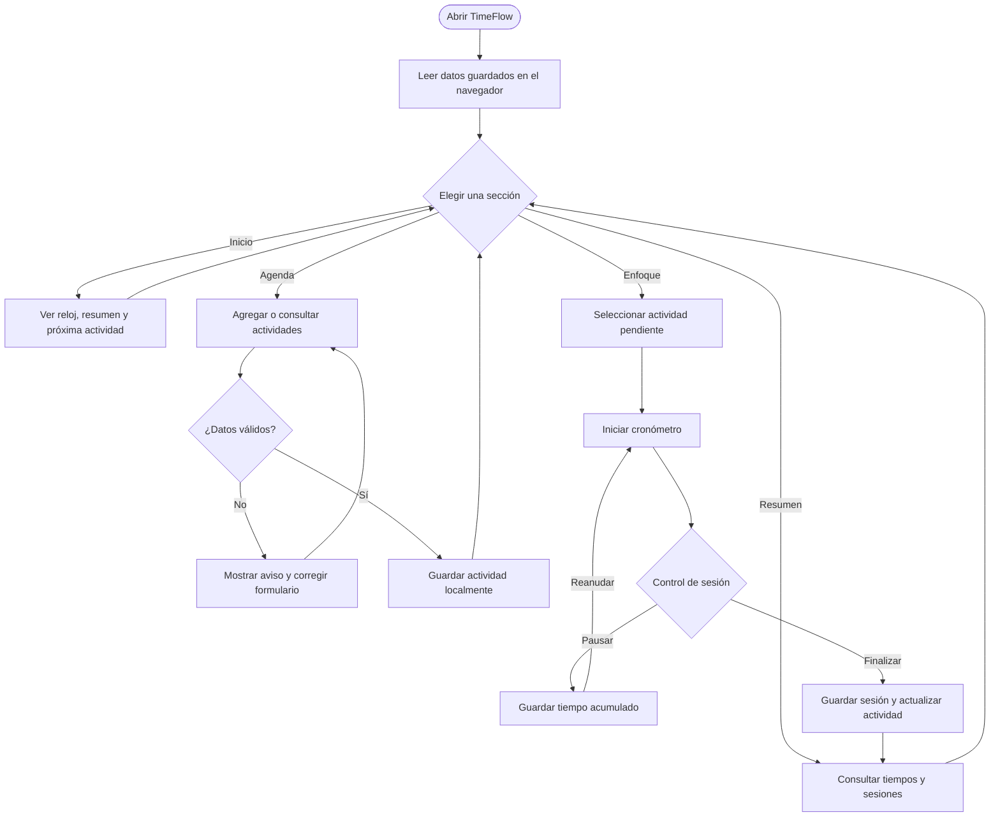

# TimeFlow

**TimeFlow** es una aplicación sencilla para organizar actividades, concentrarse en una tarea y consultar el tiempo registrado. Esta versión funciona directamente en el navegador con HTML, CSS y JavaScript, sin instalaciones ni dependencias externas.

## Ver la aplicación

Abre [`index.html`](./index.html) en un navegador. Las actividades y sesiones se guardan automáticamente en el almacenamiento local del navegador (`localStorage`). Por eso, permanecen en el mismo navegador y dispositivo donde se crearon.

## Funciones

- Crear actividades con fecha, horario y categoría.
- Filtrar la agenda por actividades pendientes o completadas.
- Marcar actividades como completadas o eliminarlas.
- Iniciar, pausar, reanudar y finalizar sesiones de enfoque.
- Consultar el tiempo registrado por actividad y el historial de sesiones.
- Usar la interfaz desde escritorio, tableta o móvil.

## Flujo de uso

Este diagrama se visualiza directamente en GitHub mediante Mermaid:



## Pseudocódigo

```text
INICIO
  cargar actividades y sesiones desde el navegador

  mientras la aplicación esté abierta:
    mostrar la sección elegida

    si se agrega una actividad:
      validar nombre, fecha y horario
      guardar actividad

    si se inicia una sesión:
      asociar cronómetro con actividad pendiente
      actualizar el tiempo mientras corre

    si se pausa o finaliza la sesión:
      guardar tiempo acumulado

    si se consulta el resumen:
      calcular totales y mostrar el historial
FIN
```

## Publicar en GitHub Pages

1. Sube `index.html` y `README.md` a la raíz de tu repositorio de GitHub.
2. Abre **Settings → Pages** en el repositorio.
3. En **Build and deployment**, elige **Deploy from a branch**.
4. Selecciona la rama principal (`main`) y la carpeta `/(root)`, y guarda.
5. Cuando termine la publicación, GitHub mostrará el enlace de tu sitio en esa misma sección.

GitHub renderiza el diagrama Mermaid y el pseudocódigo de este README en la página del repositorio.

## Estructura

```text
TimeFlow/
├── index.html   # Aplicación web completa: interfaz, estilos y lógica
└── README.md    # Guía, flujo de uso y publicación
```

## Privacidad y almacenamiento

Los datos de esta versión se guardan en el navegador mediante `localStorage`; no se envían a un servidor. Borrar los datos del sitio en el navegador también elimina las actividades y sesiones guardadas.
